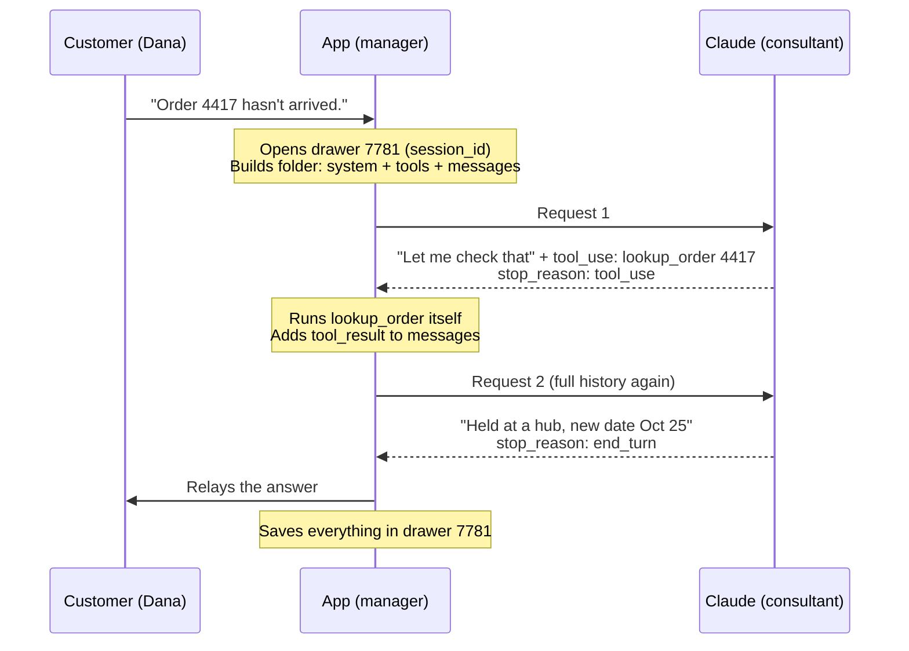

# CCA-F-Notes
These are my notes and understanding of the material that covers CCA-F Claudes Certified Architect - Foundations exam. This should have definitions and models to help me understand how to make a application with claude efficently so I can hopefully not use too many tokens when building with AI. 

<b>Vocab</b>
- App = Manager
- Claude = Consultant
- User = Customer
These above should be kept in mind as I will be using them when I go through and make examples of how Claude, the Application, and the User interact when requests are made and what task each side handles. 
- session_id = in example terms it is a drawer, it is created by the app to organize the conversation between it, Claude, and the user
- message = in example it is a folder, it is also created by the app to forward the conversation from the user to Claude, it is how the app, the user, and Clade communicate. Along with the text history the system prompt and tools are sent to Claude
- stop_reason = it is given on each of Claude's response and tells the app why Claude stopped, examples look like: stop_reason: tool_use OR stop_reason: end_turn
- tool_use = it is Claude saying, "Run this tool, call me again when the results"
- tool_result = it is send by the app to messages which is taken by Claude to use further
- end_turn = it is Claude saying, " I am finished, show this reply to the user"
- system prompt = the rule card, the developer writes it, the app sends it, and Claude reads it in messages. Example: You are an agent who helps customers find their orders
- "role:" = roles given inside the app put into session_id and messages that are passed along to Claude to help it know what it has said and what the app has said. Roles alternate as user then assistant
    - role: user = often the customer and occasionally the application sending anything to Claude
    - role: assistant = always Claude
    - role: system = always the developer, specifically their rules
- max_token = set by developer for how long Claude's response can be. Limits Claude's single response, will cut off response mid-sentence, returns stop_reason: max_tokens
- token = small chunk of text about 3/4 of a word
- stateless = Claude remembers nothing between calls, needs to be rebuilt and sent through messages every time
- enum = enumeration, fixed list of allowed values that constraints Claude to select from instead of creating its own
- agentic loop = the user and assistant going back and forth with tool_use and tool_result requests until end_turn is reached. The loop lives in the app, not Claude

<b>General Rules</b>
- Claude is stateless, it never sees anything besides what is provided in messages and re-reads conversations as new since it holds no history.
- The app cannot do anything by itself and is built to only handle requests and send information back and forth.
- 

<b>Example of agentic loop</b>
# The agentic loop: customer, manager, consultant

A walkthrough of one support chat, showing who does what at each step.

| Analogy | Real term | Job |
|---|---|---|
| Customer (Dana) | **user** | Sends messages |
| Manager | **App** | Runs tools, keeps history, reads `stop_reason` |
| Consultant | **Claude** | Reads the folder, writes replies |
| Rule card | **System prompt** | Developer's instructions for Claude |
| Folder | **The request** (`system` + `messages` + `tools`) | Rebuilt in full on every call |
| Drawer 7781 | **session_id** + stored history | Stays at the app, never sent to Claude |

## The whole loop at a glance



## Step by step

Click each step to open it.

<details>
<summary><b>Step 1: Before anyone talks</b> (App)</summary>

The manager keeps a drawer for every conversation, labeled with a session_id (7781). He also keeps a rule card: "You are a support agent for Acme. Be brief." That rule card is the system prompt.

> ⚠️ **Watch:** the system prompt is the rule card the manager hands to the consultant: words for Claude. It is not the app or "the system."

</details>

<details>
<summary><b>Step 2: Dana walks in</b> (Customer)</summary>

"Hi, I'm Dana. Order 4417 hasn't arrived."

</details>

<details>
<summary><b>Step 3: Manager builds the folder</b> (App)</summary>

He opens drawer 7781 (empty, since it's a new chat), files Dana's message, and hands the consultant a folder:

```
system:   rule card
tools:    get_customer, lookup_order, process_refund
messages:
  user:   Hi, I'm Dana. Order 4417 hasn't arrived.
```

> ⚠️ **Watch:** the session_id stays in the manager's office. The consultant never sees the drawer, only the folder.

</details>

<details>
<summary><b>Step 4: Consultant replies</b> (Claude)</summary>

He says "Let me check that, Dana" and writes a note: look up order 4417. Then he sticks a label on his reply.

`stop_reason: tool_use`

> ⚠️ **Watch:** the consultant asks. He never runs the lookup himself, and he doesn't loop.

</details>

<details>
<summary><b>Step 5: Manager reads the label</b> (App)</summary>

The label says `tool_use`, so the consultant isn't finished. The manager does NOT relay "Let me check that" and walk out. He runs `lookup_order` himself: shipped Oct 20, held at a hub, new delivery Oct 25.

> ⚠️ **Watch:** `stop_reason` is a label on every reply, read by the app. It isn't a stop command. `tool_use` means "keep going."

</details>

<details>
<summary><b>Step 6: Manager hands back the full folder</b> (App)</summary>

The consultant remembers nothing from a minute ago, so the folder must hold everything again, now with the result added:

```
system:   rule card
messages:
  user:      Hi, I'm Dana. Order 4417 hasn't arrived.
  assistant: Let me check that, Dana.
             [tool_use: lookup_order 4417]
  user:      [tool_result: shipped Oct 20, held at hub,
              new delivery Oct 25]
```

> ⚠️ **Stateless:** every hand-off starts from zero. If the result isn't in the folder, it doesn't exist for the consultant. Note the `tool_result` sits under `user`, because it's the app speaking.

</details>

<details>
<summary><b>Step 7: Consultant answers</b> (Claude)</summary>

"Your order shipped Oct 20 but was held at a hub. New delivery date: Oct 25."

`stop_reason: end_turn`

> ⚠️ **Watch:** `end_turn` is the label on the reply, not the reply itself. The answer is the text above.

</details>

<details>
<summary><b>Step 8: Manager closes the turn</b> (App)</summary>

He reads `end_turn`, relays the answer to Dana, and saves the whole exchange in drawer 7781. This turn's loop is over.

</details>

<details>
<summary><b>Step 9: Dana's next message</b> (Customer → App)</summary>

"Can I just get a refund?" The manager opens drawer 7781 and sends the entire history, plus this new line, in a fresh folder.

> ⚠️ **Watch:** if the manager sent only the new line, the consultant would ask "What's your order number?" The fix is the plumbing, not the rule card.

</details>

<details>
<summary><b>Step 10: Same loop, new tool</b> (Claude → App)</summary>

The consultant writes a note, `process_refund 4417`, labeled `tool_use`. The manager decides whether to run it (he holds the keys), runs it, and returns the result. The consultant confirms the refund, labeled `end_turn`. The manager relays it to Dana.

`tool_use → end_turn`

</details>

## stop_reason cheat sheet

| stop_reason | Meaning | What the app does |
|---|---|---|
| `tool_use` | Claude wants a tool run | Runs it, adds `tool_result`, calls Claude again |
| `end_turn` | Claude finished | Shows the reply to the user |
| `max_tokens` | Claude ran out of room | Treats the reply as incomplete |

